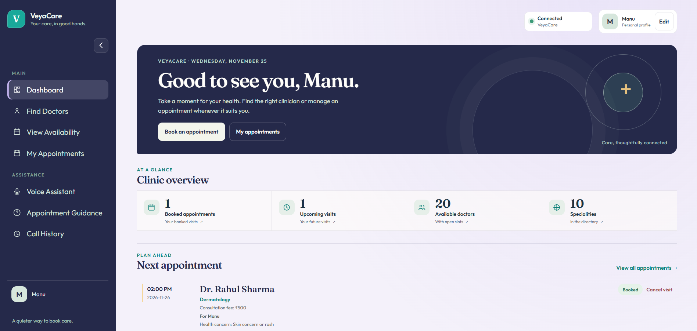
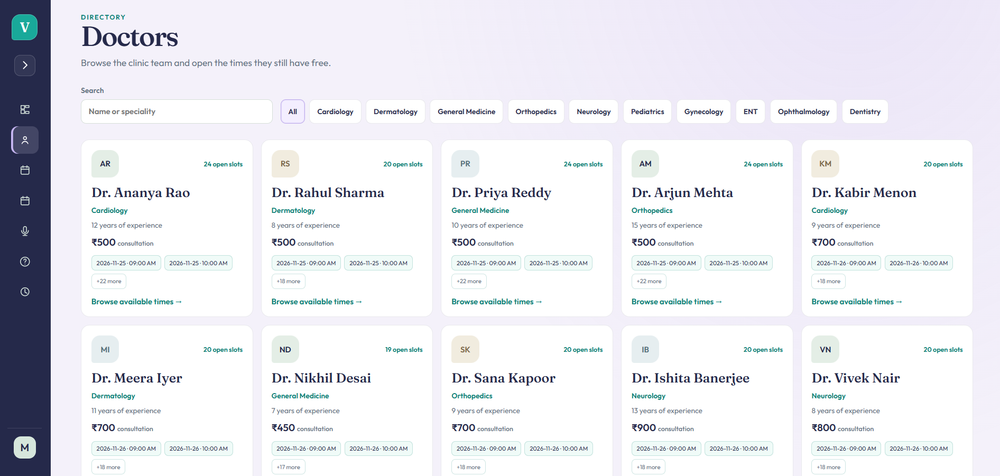
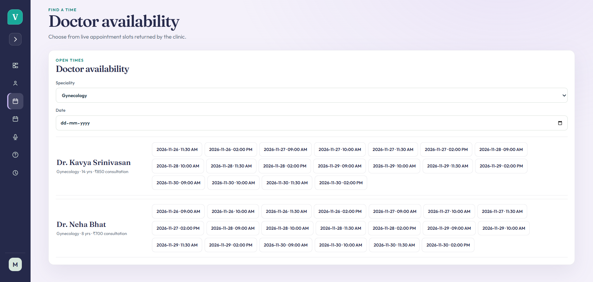
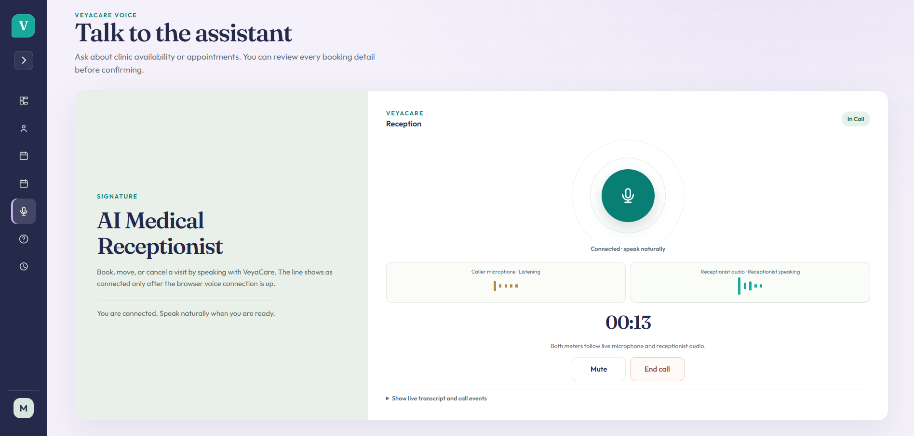
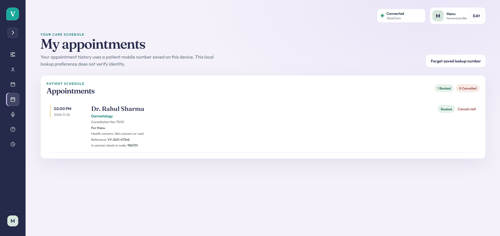
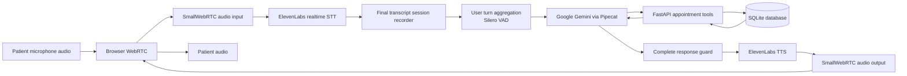

# VeyaCare – Voice AI Medical Receptionist

**A web-based clinic appointment assistant with a voice-first booking experience.**

VeyaCare helps patients browse doctors, check real appointment availability, and book or manage appointments through a React interface or a WebRTC voice conversation. The frontend connects to a FastAPI backend that uses SQLite for clinic and appointment data.

## Dashboard Preview

Add your real screenshots to `docs/screenshots/` using the filenames below. These image references are placeholders; no screenshots are included yet.



*Main Dashboard — clinic overview and upcoming appointment information.*



*Find Doctors — doctor directory with speciality, experience, and consultation fee.*



*Doctor Availability — real slots returned by the backend.*



*Voice Assistant — WebRTC call controls and on-screen conversation.*



*My Appointments — patient-specific appointment history and cancellation controls.*

## Table of Contents

- [About the Project](#about-the-project)
- [Key Features](#key-features)
- [Voice AI Architecture](#voice-ai-architecture)
- [Technology Stack](#technology-stack)
- [Application Pages](#application-pages)
- [Project Structure](#project-structure)
- [Installation and Setup](#installation-and-setup)
- [Environment Variables](#environment-variables)
- [Running the Application](#running-the-application)
- [Testing](#testing)
- [Demo Video](#demo-video)
- [Future Improvements](#future-improvements)
- [Author](#author)

## About the Project

Clinic appointment booking often requires patients to navigate doctor options, availability, and appointment details across separate steps. VeyaCare brings those tasks together in one local web application and adds a spoken receptionist experience for callers who prefer voice interaction.

The frontend loads doctor and slot data from the backend. The backend validates booking and cancellation requests and stores doctors, time slots, and appointment history in SQLite. The voice assistant uses the same backend appointment tools, so it checks availability and performs booking operations against the application data rather than inventing slots.

VeyaCare does not implement user authentication. The optional phone number saved in browser storage is a device-local appointment lookup preference, not proof of identity. Backend appointment lookup and cancellation also rely on the supplied phone number; they are not an authentication system.

## Key Features

- Browse the clinic's doctor directory, including speciality, years of experience, and consultation fee.
- Filter and view appointment availability returned by the backend.
- Book an appointment with patient details and a selected available doctor and slot.
- View patient-specific appointment history, including booked and cancelled appointments, using the locally saved phone lookup preference.
- Cancel an active appointment with an explicit confirmation step while retaining its cancelled history.
- View booking reference and six-digit check-in code after a successful booking.
- Use a browser-based WebRTC voice assistant with live transcript display and spoken responses.
- Select a health concern from the configured categories, with an additional description for “Other.”
- View recent call history stored in browser local storage.
- Use appointment guidance content in the frontend.

Voice and web booking safeguards require a valid 10-digit Indian mobile number and confirmation before a voice booking proceeds. The voice flow also requires confirmation of the final appointment summary. Database success is required before the assistant reports a booking or cancellation as complete.

## Voice AI Architecture

The browser establishes a WebRTC session with the FastAPI backend using Pipecat's SmallWebRTC transport. For each new connection, the backend creates an isolated voice pipeline. The pipeline records final caller transcriptions for session state, aggregates caller turns with Silero VAD, routes tool calls to the backend appointment logic, and returns generated speech to the browser.



Google Gemini handles the conversation and invokes registered tools for operations such as availability lookup, appointment listing, booking, and cancellation. FastAPI and the shared backend logic validate those operations and read or write the SQLite database. ElevenLabs provides realtime speech-to-text and text-to-speech. Pipecat connects the transport, speech services, model, tools, and conversation context.

## Technology Stack

| Area | Technologies used |
| --- | --- |
| Frontend | React 19, Vite 8, JavaScript, CSS |
| Backend | Python, FastAPI, Uvicorn, Pydantic |
| AI and voice | Pipecat, Google Gemini, ElevenLabs realtime STT and TTS, Silero VAD, SmallWebRTC |
| Database | SQLite, SQLAlchemy |
| Testing and quality | Python `unittest`, Node.js built-in test runner, ESLint |

The checked-in Python requirements file does not pin individual package versions. The frontend dependency versions are described in `frontend/package.json` and locked in `frontend/package-lock.json`.

## Application Pages

The frontend uses client-side routes defined in `frontend/src/routes.js`.

| Page | Route | Functionality |
| --- | --- | --- |
| Dashboard | `/` | Clinic overview, available doctor and speciality counts, and patient-specific upcoming appointment information. |
| Doctors | `/doctors` | Browse doctors and their speciality, experience, and fee. |
| Availability | `/availability` | Filter real availability and select a doctor and slot for booking. |
| My Appointments | `/my-appointments` | Load appointment history for the locally saved patient phone and manage active appointments. |
| Voice Assistant | `/voice-assistant` | Start and manage a WebRTC voice call and view the on-screen conversation. |
| Call History | `/call-history` | Review call records retained in browser local storage. |
| Appointment Guidance | `/appointment-guidance` | Read the application's appointment guidance. |

## Project Structure

```text
Voice AI Doc/
├── backend/
│   ├── .env.example
│   ├── app/
│   │   ├── main.py                 # FastAPI app, routes, startup initialization
│   │   ├── database.py             # SQLAlchemy engine and session
│   │   ├── models.py               # Doctor, slot, and appointment models
│   │   ├── schemas.py              # Request validation models
│   │   ├── tools.py                # Shared availability and appointment operations
│   │   └── voice/                  # Pipecat pipeline and voice appointment tools
│   ├── tests/
│   │   └── test_backend.py
│   └── requirements.txt
├── docs/
│   └── screenshots/                # Add the dashboard screenshots referenced above
├── frontend/
│   ├── public/
│   ├── src/
│   │   ├── api/                    # FastAPI client
│   │   ├── components/
│   │   ├── context/
│   │   ├── hooks/
│   │   ├── pages/
│   │   ├── utils/
│   │   └── voice/                  # Browser WebRTC client
│   ├── package.json
│   └── package-lock.json
├── .gitignore
└── README.md
```

Generated build files, Python virtual environments, `node_modules`, local environment files, and SQLite database files are excluded from this structure and from Git.

## Installation and Setup

### Prerequisites

- Windows PowerShell
- Python 3.12
- Node.js 20.19 or newer, or 22.12 or newer (required by the Vite 8 toolchain)
- npm
- Google Gemini API credentials and an ElevenLabs API key and voice ID for voice calls

The browser interface can use the backend APIs without starting a voice session. Voice calls require all three provider credentials listed in the environment section.

### 1. Set up the backend

```powershell
cd "D:\Voice AI Doc\backend"
py -3.12 -m venv .venv
.\.venv\Scripts\Activate.ps1
python -m pip install --upgrade pip
pip install -r requirements.txt
```

Create a local environment file from the safe template only if one does not already exist:

```powershell
if (-not (Test-Path .env)) { Copy-Item .env.example .env }
notepad .env
```

Replace the placeholders in `backend/.env` with your own credentials. Keep that file private; `.env` is ignored by Git. Do not paste secrets into the README or commit them.

### 2. Set up the frontend

In a separate PowerShell terminal:

```powershell
cd "D:\Voice AI Doc\frontend"
npm ci
```

The frontend API client defaults to `http://127.0.0.1:8001`. To use a different backend URL, set `VITE_API_BASE_URL` in a local Vite environment file such as `frontend/.env.local`, for example:

```dotenv
VITE_API_BASE_URL=http://127.0.0.1:8001
```

Vite environment variables are embedded into the frontend build; do not put provider API credentials in frontend environment files.

## Environment Variables

Copy `backend/.env.example` to `backend/.env`. The backend reads that file directly.

| Variable | Required | Purpose |
| --- | --- | --- |
| `GOOGLE_API_KEY` | Yes, for voice | Google Gemini API credential. |
| `GEMINI_MODEL` | No | Gemini model name; defaults to `gemini-2.5-flash` in the backend configuration. |
| `ELEVENLABS_API_KEY` | Yes, for voice | ElevenLabs API credential used by realtime STT and TTS. |
| `ELEVENLABS_VOICE_ID` | Yes, for voice | ElevenLabs voice selected for spoken responses. |
| `APP_ENV` | No | Application environment label; defaults to `development`. |

The frontend also accepts the optional `VITE_API_BASE_URL` setting described above. It defaults to `http://127.0.0.1:8001` in `frontend/src/api/client.js`.

## Running the Application

Start the backend from the `backend` directory. This keeps the relative SQLite URL pointed at `backend/appointments.db`.

```powershell
cd "D:\Voice AI Doc\backend"
.\.venv\Scripts\python.exe -m uvicorn app.main:app --host 127.0.0.1 --port 8001
```

Start the frontend in another terminal:

```powershell
cd "D:\Voice AI Doc\frontend"
npm run dev -- --host localhost
```

The project's configured local defaults are:

| Service | URL |
| --- | --- |
| Frontend | <http://localhost:5173> |
| Backend health check | <http://127.0.0.1:8001/health> |
| Backend API documentation | <http://127.0.0.1:8001/docs> |

The backend CORS allowlist includes frontend origins at `localhost:5173` and `127.0.0.1:5173`. These are the code-configured development URLs; the README does not assert that a server is currently running.

### Backend API

| Method | Endpoint | Purpose |
| --- | --- | --- |
| `GET` | `/` | Basic service response. |
| `GET` | `/health` | Health status. |
| `GET` | `/api/doctors` | Doctor directory with speciality, experience, and consultation fee. |
| `GET` | `/api/visit-reasons` | Configured visit-reason options. |
| `GET` | `/api/health-concerns` | Configured health-concern categories. |
| `GET` | `/api/availability?speciality=...&date=YYYY-MM-DD` | Available doctors and slots, with optional filters. |
| `GET` | `/api/appointments?phone_number=...` | Appointments matching the required 10-digit Indian mobile number. |
| `POST` | `/api/appointments` | Create an appointment using the supplied doctor, slot, patient, phone, and concern details. |
| `POST` | `/api/appointments/cancel` | Cancel an appointment matching the supplied appointment ID and phone number. |
| `POST` | `/api/offer` | Create or negotiate a SmallWebRTC voice session. |
| `PATCH` | `/api/offer` | Exchange ICE candidate updates for a voice session. |

The HTTP appointment endpoints do not authenticate patients. The frontend cancellation flow and voice assistant ask for confirmation before cancellation; a direct API request does not provide caller authentication. The voice booking flow adds its own spoken phone and final appointment confirmation steps.

## Testing

Run backend tests from `backend`:

```powershell
cd "D:\Voice AI Doc\backend"
.\.venv\Scripts\python.exe -m unittest discover -s tests -v
```

Run frontend tests, lint, and a production build from `frontend`:

```powershell
cd "D:\Voice AI Doc\frontend"
npm test
npm run lint
npm run build
```

The frontend tests use Node.js's built-in test runner. The tests exercise frontend utilities and routing, and backend tests use isolated test databases and test fixtures rather than making live provider calls.

## Demo Video

**Demo video:** [Add the demo video link here]

The screen recording demonstrates the interface and on-screen interactions. It does not capture the receptionist's voice audio.

## Future Improvements

These are potential future enhancements and are not represented as completed features:

- Add secure patient authentication and authorization for appointment lookup and cancellation.
- Add deployment configuration and production observability for the API and voice pipeline.
- Add broader automated frontend interaction coverage and browser-based end-to-end tests.
- Evaluate voice turn-taking, transcription accuracy, and interruption handling across more devices, accents, and noisy environments.
- Add a real voice audio track to a future demonstration recording, with appropriate consent and privacy handling.

## Author

**Manogna Ganji**
